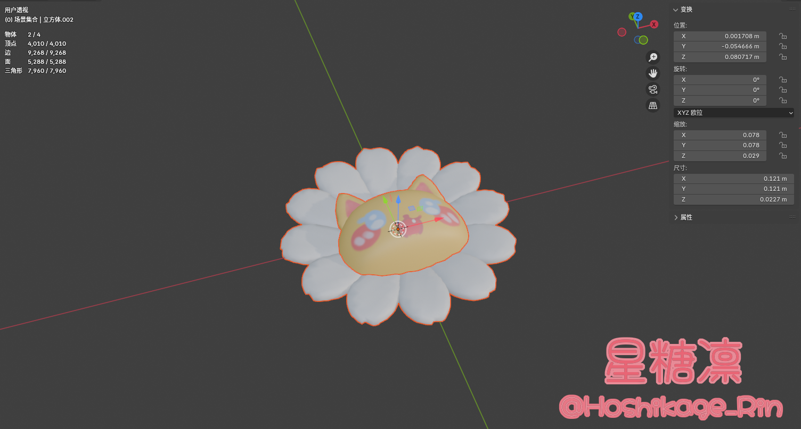
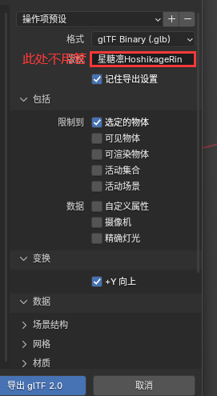
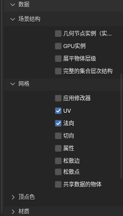
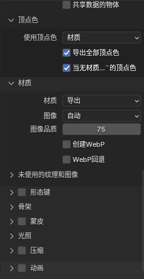

  <b>简体中文</b> | <a href="./README_EN.md">English</a>

# 星糖凛布料解压站

✨ 基于three.js实现的Verlet+质点算法 布料解算物理沙盒

所有运算在浏览器本地完成，图片不上传服务器。

~~这网站其实是我做着玩的 哈哈~~ =w=

✅ 功能

- 拖拽、撕扯、刀割、红线固定约束
- 大量布料材质预设：丝绸、雪纺、牛仔、扎染、蜡染、镭射等
- 支持法线贴图、程序化纹理
- 可爱装饰挂件，（挂件模型均为本人原创 Ow<✨）可导入自定义 GLB 模型
- 风力、重力、自碰撞、水珠特效
- 适合解压放松，也可作为 Live2D / Spine / Creature 裙摆飘带动画参考

🎀 关于自定义装饰

需确保正面朝向上（正面在Z轴上） 同时物体的最大宽度不得超过0.12m以免造成碰撞异常
具体如图所示

导出设置如下

1 
2 
3 

💡 推荐 Chrome / Edge；网格分辨率越高，性能开销越大

📌 仅供个人学习娱乐使用 
