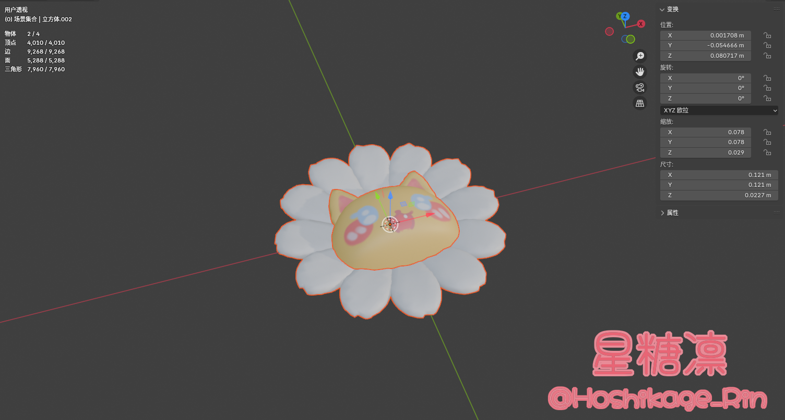
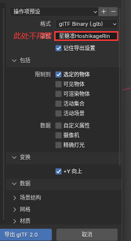
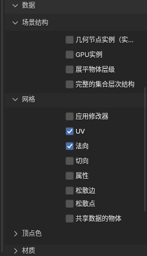
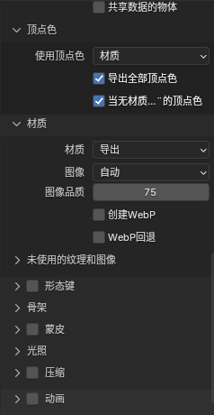

  <a href="./readme.md">简体中文</a> | <b>English</b>

# HoshikageRin's Cloth Relax

✨ A cloth simulation physics sandbox based on three.js using Verlet + Point-Mass algorithm

All calculations are done locally in the browser, images are not uploaded to any server.

~~This website is actually just made for fun, haha~~ =w=

✅ Features

- Drag, tear, cut, and pin constraints (red lines)
- A large variety of cloth material presets: silk, chiffon, denim, tie-dye, batik, holographic, etc.
- Supports normal maps and procedural textures
- Cute decorative pendants (all pendant models are originally created by me Ow<✨), supports importing custom GLB models
- Wind, gravity, self-collision, water drop effects
- Great for relaxation, and can also serve as a reference for Live2D / Spine / Creature skirt/sway physics

🎀 About Custom Decorations

Make sure the front faces up (front is on the Z-axis). Also, the maximum width of the object must not exceed 0.12m to avoid collision anomalies.
As shown in the image:

Export settings are as follows:

1 
2 
3 

💡 Chrome / Edge recommended; higher mesh resolution increases performance overhead.

📌 For personal learning and entertainment use only.